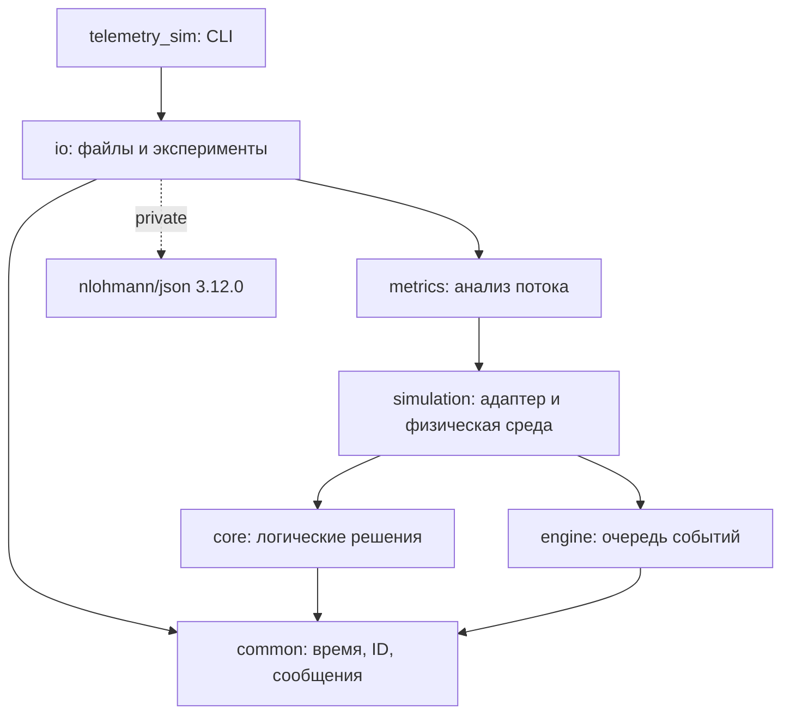

# Архитектура стенда

Стенд исполняет одну дискретно-событийную модель в одном потоке. Техническое описание опирается на фактические цели [CMake](../CMakeLists.txt), публичные заголовки и [контракт](model_contract.md). Установка, сборка и CLI: [README](../README.md).

## Модули и зависимости

Стрелка обозначает зависимость цели слева от цели справа. Все библиотеки — STATIC; общий код времени находится в common.

| Модуль | Владение и ответственность | Основной API |
|---|---|---|
| common | Целые время/длительности, ID, проверенная арифметика, сообщения | [time.hpp](../include/telemetry/common/time.hpp), [ids.hpp](../include/telemetry/common/ids.hpp), [messages.hpp](../include/telemetry/common/messages.hpp) |
| core | TaskStore, FIFO, текущие назначения и попытки; LoadLedger, RR/LL; детектор каждого узла; совместная реконфигурация | [Dispatcher](../include/telemetry/core/dispatcher.hpp), [Detector](../include/telemetry/core/detector.hpp) |
| engine | Общая очередь непрозрачных действий, время, фаза, tie key, последовательность; исполнение до горизонта | [EventLoop](../include/telemetry/engine/event_loop.hpp) |
| simulation | Неизменяемый Scenario/PhysicalTrace; фактические узлы, физические очереди; перевод наблюдений и команд между средой и core | [Simulation](../include/telemetry/simulation/simulation.hpp), [PhysicalEnvironment](../include/telemetry/simulation/physical_environment.hpp) |
| metrics | Независимое восстановление состояния из типизированного журнала, показатели и инварианты | [Analyzer](../include/telemetry/metrics/analysis.hpp) |
| io | Строгий JSON/CSV, кодек журнала, снимки/manifest, отчёты, compare/generate/batch и подготовка выходного каталога | [run_output.hpp](../include/telemetry/io/run_output.hpp), [experiments.hpp](../include/telemetry/io/experiments.hpp) |
| app | Разбор CLI, выбор команды, диагностика и коды выхода | [main.cpp](../app/main.cpp) |

Core и engine зависят только от common; отсутствие дополнительных зависимостей проверяется при настройке CMake. Core не включает engine, не читает файлы и не использует RNG. Engine не знает задач, heartbeat и ALIVE/FAILED. JSON приватен для IO; алгоритмические модули, metrics и CLI не включают его заголовки. Информация о сборке сериализуется в IO, сгенерированные константы находятся в common.

## Поток исполнения и владение состоянием

IO валидирует входы и создаёт `shared_ptr<const Scenario>`. `compare` передаёт один снимок четырём отдельным экземплярам Simulation. Каждый владеет собственными EventLoop, Dispatcher, детекторами и PhysicalEnvironment. Позиция RR, нагрузки, поколения, попытки, очереди и физические токены не разделяются между вариантами. RNG существует только при предварительном `generate`.

Адаптер принимает физические heartbeat/результаты, передаёт наблюдения core с явным временем, преобразует TimeoutRequest в действия EventLoop и исполняет AssignmentCommand в среде. Детектор видит время/ID/номер принятого сообщения и таймер; распределитель — логическую доступность и назначения. Расписание crash, blackout, будущие задержки и настоящая работоспособность остаются в среде. Поэтому до обнаружения crash возможна отправка задачи фактически отказавшему узлу.

TaskStore хранит исходную задачу, актуальное назначение и историю попыток. Результат принимается один раз только при точном совпадении task/attempt/node с актуальным назначением. Load использует всю исходную работу текущих назначений, делённую на p; прогресс физического исполнения не уменьшает логическую нагрузку. LL выбирает точный минимум без epsilon и разрешает равенство по NodeId. RR хранит позицию следующего выбора в упорядоченном ALIVE.

Переход в SUSPECT исключает узел из новых назначений, но не отзывает работу. При всех новых FAILED одной отметки Dispatcher делает один общий возврат: сортировка по исходному поступлению/ID, добавление после уже ожидающего FIFO, отзыв актуальных попыток и снятие нагрузки ровно один раз. Старые физические очереди продолжаются до настоящего crash или завершения; логическое исключение их не отменяет. FAILED терминален. Детали: [задачи](task_state.md), [распределение](scheduling.md), [детекторы](detectors.md), [реконфигурация](reconfiguration.md).

## Время и восемь фаз

Ключ события — `(time_ticks, phase, tie_key[4], insertion_sequence)`. Никаких системных часов, указателей как ключей или случайного обхода контейнеров в порядке исполнения нет. На текущей отметке разрешено планирование только в более позднюю фазу; мгновенные последствия внутри фазы исполняются синхронно. Горизонт включён. Полные численные правила: [time.md](time.md).

| Фаза | Действие и следствие |
|---|---|
| 1 | Физический crash; завершение в той же отметке уже не даёт результат |
| 2 | Завершение, немедленный результат, запуск следующей физической задачи |
| 3 | Потенциальная отправка heartbeat |
| 4 | Доставка heartbeat, в том числе с нулевой задержкой |
| 5 | Проверки тайм-аутов; heartbeat на точном сроке уже обработан |
| 6 | Одно совместное применение конечного ALIVE и новых FAILED |
| 7 | Поступления по TaskId |
| 8 | Один dispatch накопленного FIFO; последовательные команды видят обновлённую нагрузку |

У таймеров есть поколение детектора; устаревшие действия остаются в очереди, но не меняют состояние. У физических завершений свой токен, независимый от поколения/номера попытки. Ключи равенства и обработка коллизий: [движок](event_loop.md), [адаптер](simulation.md), [физическая среда](physical_environment.md).

## Журнал, анализ и ошибки

SimulationAuditSink синхронно получает типизированное событие и ключ текущего действия. JournalWriter переводит поток в JSONL; Analyzer работает с этим же типизированным интерфейсом без доступа к состоянию Simulation. При `metrics` Reader декодирует сохранённый поток и передаёт его новому Analyzer. Выбор RR/LL и расчёт порогов повторно не моделируются: анализ проверяет согласованность журнала и вычисляет показатели.

Manifest получает `complete` после успешной записи; корректная незавершённость на горизонте отражается метриками. Исключения callback/IO и технический лимит прерывают запуск, не означают успешное достижение горизонта и не позволяют продолжить тот же Simulation. Уже сделанные изменения модели не откатываются. CLI готовит новый результат в соседнем временном каталоге; обычная ошибка сохраняет прежний результат. Это не транзакция на случай аварийного завершения процесса и не поддержка конкурентных записей. Пересчёт производных отчётов может частично записать их при ошибке носителя; источником остаётся исправный журнал. Подробнее: [журнал и метрики](journal_metrics.md), [CLI](cli.md).

## Правило модели → модуль → проверка

Имена справа — реальные тесты CTest; полный перечень выводит `ctest --test-dir build/final-debug -N`. Матрица раздела 12 плана с деталями крайних случаев: [итоговый аудит](stage_14_audit.md).

| Правило | Реализация | Проверка |
|---|---|---|
| Целые микросекунды, проверенная арифметика, положительная длительность, близкие пороги | common/time.cpp, common/checked_integer.hpp | common_time, common_numeric, common_ids |
| Core/engine независимы, JSON только IO | CMakeLists.txt, cmake/Dependencies.cmake | Настройка CMake; проверка compile_commands при передаче |
| FIFO, актуальная попытка, одно принятие | core/task_store.cpp | tasks_queue, tasks_results, tasks_retries, tasks_inputs, tasks_audit |
| RR: следующий выбор и доступность; LL: полный Load/p, точное равенство/ID | core/scheduling.cpp, core/dispatcher.cpp | scheduling_rr, scheduling_availability, scheduling_ll, scheduling_integration, scheduling_numeric |
| Прогрев адаптивного окна, sample std, frozen thresholds и поколения | core/detector.cpp | detector_fixed, detector_adaptive, detector_window, detector_generations, detector_boundaries, detector_inputs |
| Один общий сортированный отзыв, повторное FAILED без эффекта | core/dispatcher.cpp | reconfiguration_batch, reconfiguration_results, reconfiguration_availability, reconfiguration_audit, reconfiguration_inputs |
| Общий ключ событий, запрет прошлого/текущей фазы, включённый горизонт, ошибка лимита | engine/event_loop.cpp | engine_ordering, engine_phases, engine_horizon, engine_limits, engine_failures, engine_determinism |
| Настоящий crash отдельно от оценки; физическая очередь сохраняется при ложном FAILED | simulation/physical_environment.cpp | physical_fifo, physical_crash, physical_channel, physical_exclusion, physical_horizon, physical_inputs |
| Строгие входы, полнота трассы, снимок без потери целых | io/scenario_loader.cpp, simulation/scenario.cpp | scenario_valid, scenario_json, scenario_csv, scenario_ranges, scenario_immutable, scenario_examples |
| Восемь фаз, одна реконфигурация/dispatch; наблюдения без скрытого crash | simulation/simulation.cpp | integration_simultaneous, integration_boundaries, integration_isolation, integration_errors |
| Ручные baseline и Recovery; FP до crash, FN, пустые выборки и throughput (start,end] | metrics/analysis.cpp | integration_baseline, integration_crash, integration_blackout, metrics_baseline, metrics_recovery, metrics_classification, metrics_boundaries, metrics_retries |
| Канонический поток, независимый пересчёт и контроль целостности | io/journal.cpp, io/run_output.cpp | metrics_journal, metrics_files, metrics_errors, metrics_reproducibility |
| CLI и коды ошибок, одинаковый вход четырёх вариантов, отдельные повторы серии | app/main.cpp, io/run_output.cpp, io/batch.cpp, io/output_directory.cpp | commands_parsing, commands_validate, commands_run, commands_compare, commands_metrics, commands_batch, commands_overwrite, commands_failures, commands_determinism |
| Генерация до моделирования и повторная загрузка девяти демонстраций | io/generation.cpp, examples/, tests/example_tests.py | commands_generate, examples_catalog, examples_long_blackout, examples_reordered, examples_simultaneous, examples_no_alive, examples_unfinished, examples_reload, examples_generator, examples_batch |
| Конечная нагрузка, уникальное принятие, баланс, обратный порядок вариантов | tests/final_verification.py, tests/data/load_smoke.json | final_load_smoke; отчёт stage14-load/report.json |
| Воспроизводимая передача | README.md, docs/{architecture,time,experiments}.md | Фактически выполненные команды и проверка ссылок: stage_15_audit.md |

Пути реализации в таблице указаны относительно `src/`, кроме явно названных `common/checked_integer.hpp` (в `include/telemetry/`), CMake, tests, examples и docs. Размер собственного кода, тестов, данных и документации подсчитан отдельно в [отчёте этапа 15](stage_15_audit.md); загруженные зависимости и результаты в него не входят.
